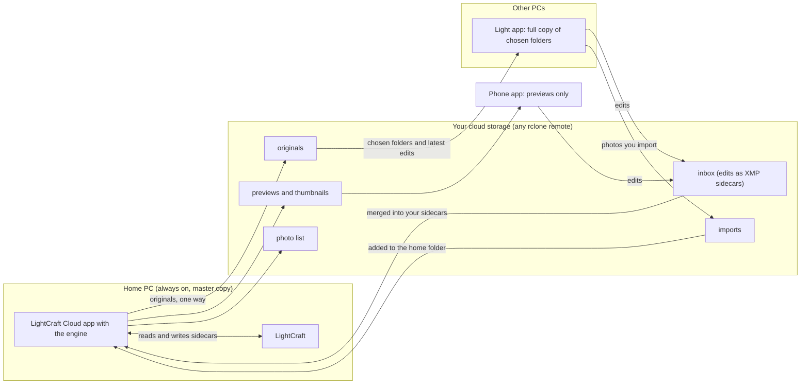

# LightCraft Cloud

Lightroom-style sync for [LightCraft](https://github.com/storytold/lightcraft), using your own cloud storage. Your home PC stays the master copy, and there is no server of ours in between.

What you get:

* Browse your library on your phone and edit photos there. The edits come back to LightCraft on your PC.
* Keep a full copy of chosen folders on a second PC, edit there too, and import new photos there.
* Use any cloud storage that [rclone](https://rclone.org) supports: Google Drive, OneDrive, S3, WebDAV, SFTP and more.

## How the parts fit

Three rules hold everywhere:

* The home PC is the master. Originals go out from it to the cloud and your other PCs, and photo files are never changed. A new photo imported on another PC goes to the home PC first, then out like any other.
* Edits travel back as small XMP sidecar files through the inbox. The home PC merges them into its own sidecars.
* Deletions spread only from the home PC. Deleting on another PC only affects that PC.

## The parts

| Part | What it is | Where |
| --- | --- | --- |
| Phone app | Android app. Shows thumbnails and small previews, lets you edit, sends the edits back. Holds no originals. | [lightcraft-android](https://github.com/tinytom21/lightcraft-android), downloads on its [Releases](https://github.com/tinytom21/lightcraft-android/releases) page |
| Home PC app | Tray app on the PC where your master library lives. Publishes your photo folder, makes previews with LightCraft's engine, applies edits that arrive. Linux and Windows (x86-64). | This repository, [Releases](https://github.com/tinytom21/lightcraft-cloud/releases) |
| Other-PC app | The same tray app without the engine. Keeps a copy of the folders you choose, sends back edits and imported photos. Windows and Linux. | This repository, [Releases](https://github.com/tinytom21/lightcraft-cloud/releases) |

The PC apps are one program, `lightcraft-cloud-desktop`, built two ways (the *home* build with the engine, the *light* build without). The phone app is a fork of LightCraft for Android.

## What it does, day to day

* **Edits.** Edit a photo in LightCraft on any PC, or on the phone. The edit is saved as an XMP sidecar next to the photo, travels through the cloud and ends up on every device. If two devices changed the same photo, the edits are merged, as described below.
* **Imports.** On another PC, import photos in LightCraft into the synced folder, in any folder structure you like. The app keeps your folder structure, sends the photos to the home PC, and they appear in LightCraft there.
* **Live progress.** While it works, the Status window and the tray tooltip show what it is doing, how far along it is and about how long is left, and say so if nothing has moved for a while.
* **Refresh of LightCraft.** The app tells your running LightCraft about new photos and new edits, so you do not have to run Synchronize Folder. This needs LightCraft to be running and its control port to be on (see Quick start).

## If two devices edit the same photo

Usually neither edit is thrown away. Both go to the home PC, which merges them setting by setting, using the version each device started from. This works the same for a laptop that was offline for a week.

* **Different settings** (exposure on the phone, a rating on the laptop): both are kept.
* **The same setting, changed differently:** the edit sent last wins that setting. "Last" means when the device sent the edit, by its own clock, not when you made it.
* **Crop, geometry, tone curve, profile and white balance** each count as one unit, and so do masks and spots. If both sides changed anything inside one, the later edit's whole unit wins.
* **If the edits can't be merged safely** (the starting version is gone, a file can't be read, the edits use different LightCraft settings formats), the newest edit wins the whole file.

The version that gets replaced or loses is saved in the home PC's history (`history/` in its state folder), and every incoming edit stays in the cloud for 30 days. Clashes are written to the log, and getting a losing version back is a manual file copy: there is no screen for it yet. Photo files are never modified. Details: [FORMAT.md](FORMAT.md#conflict-policy).

## Quick start

Setup is manual today. You need an rclone remote for your cloud storage (`rclone config`). The phone connects with a config file exported from the PC. There is no QR pairing.

Downloads are on the [Releases](https://github.com/tinytom21/lightcraft-cloud/releases) page (from v0.2.0; the Windows home PC one from v0.2.1):

| File | For |
| --- | --- |
| `lightcraft-cloud-<version>-windows-setup.exe` | Windows, another PC. A normal installer; no administrator needed. |
| `lightcraft-cloud-<version>-windows-home-setup.exe` | Windows, the home PC (with the engine). The same kind of installer. |
| `lightcraft-cloud-<version>-linux-light.tar.gz` | Linux, another PC (no LightCraft engine). |
| `lightcraft-cloud-<version>-linux-home.tar.gz` | Linux, the home PC (with the engine). |
| `SHA256SUMS` | checksums of the four files above. |

The two Windows installers are the same program in two builds, so they install in the same place and one goes over the other. The home one goes over an
installed other-PC app (an upgrade, with your settings). The other-PC installer refuses to go over the home one and changes nothing, because that would stop
the home PC from publishing; uninstall first if you really want that. An app updates only to its own kind: a home app never installs the other-PC installer, and the other way round.

Each Linux archive holds the program, `librclone.so`, the licences and an `install.sh`. Unpack it and run `./install.sh`: it puts the
program in `~/.local/bin` and the library in `~/.local/lib/lightcraft-cloud/`, where the app looks for it. It needs no `sudo`.
The Linux programs need glibc 2.35 or newer (Ubuntu 22.04, Debian 12, Fedora 36 or newer).

**1. LightCraft settings, on every PC.** In LightCraft open Settings, then the Import tab. Under XMP sidecars tick **Automatically write changes into XMP sidecars** and set **Sidecar names** to `IMG_1.CR3.xmp`. Without this, edits stay inside LightCraft and are never sent.

**2. LightCraft control port, on every PC.** This lets the app tell LightCraft about new photos and edits. The port listens on this PC only and has no password. Then restart LightCraft.

* Linux Flatpak: `flatpak override --user --env=LIGHTCRAFT_CONTROL_PORT=7980 ai.storyteller.lightcraft`
* Windows: `setx LIGHTCRAFT_CONTROL_PORT 7980`

**3. Home PC (Linux or Windows).**

1. Linux: download `lightcraft-cloud-<version>-linux-home.tar.gz` from Releases, unpack it and run `./install.sh`, then start `lightcraft-cloud-desktop`.
   Windows: run `lightcraft-cloud-<version>-windows-home-setup.exe` and start LightCraft Cloud from the Start menu. Setup opens on the first run.
2. Choose **This is my home PC**, your photo folder (the folder your photos are in, for example `D:\Photos` on Windows; never your LightCraft library folder) and your rclone remote with a folder on it.
3. Choose "Originals and previews", or "Previews only" if you do not want the originals in the cloud.
4. Save. The first sync starts and uploads the library.

The app only renders on the home PC: it works on a scratch library of its own in its state folder and never opens, locks or changes your LightCraft library.

**4. Another PC.**

1. Windows: run `lightcraft-cloud-<version>-windows-setup.exe` from Releases (not the home one). Linux: unpack `lightcraft-cloud-<version>-linux-light.tar.gz` and run `./install.sh`.
2. Start it. Setup opens on the first run. Choose **This is another PC**.
3. Pick the cloud library, a photo folder on this PC, and tick the folders to keep.
4. Add that photo folder to LightCraft, and set LightCraft's import destination to it.

**5. Phone.**

1. Install the APK from the [phone app Releases](https://github.com/tinytom21/lightcraft-android/releases).
2. On the home PC, export a phone-only rclone remote to a config file, and copy it to the phone.
3. In the app's Preferences pick the file, the remote and a name for the phone. The [phone guide](https://github.com/tinytom21/lightcraft-android/blob/lightcraft-cloud/apps/lightcraft-android/docs/cloud-library.md) has the steps.

**Updates.** The app looks on GitHub once a day for a newer published release (the request carries only the app's name and version in its User-Agent, nothing about you or your library;
switch it off with "Check for new versions" in Settings). When there is one, the tray menu and the Status window say so. On Windows, **Update now**
downloads the installer of its own kind, checks it against the release's `SHA256SUMS`, waits until no sync is running, installs it and restarts the app. On Linux it only links to the
release; unpack the new archive and run `./install.sh` again. Nothing is ever installed without a click.

## Status and limits

This is early software.

* Albums and uploading photos from the phone are not built.
* The Windows installers and programs are not code-signed, so Windows SmartScreen warns when you first run the installer. The update check compares the installer with a checksum file from the same GitHub release: that catches a damaged download, not a release published by someone who has taken over the GitHub account.
* A Mac build does not exist. The home PC app runs on Linux and on Windows 10 or 11 (x86-64); there is no ARM build of either.
* The Windows home PC app has been built and tested on a real Windows (a CI runner), but not yet used on a real home PC's tray and desktop. What differs from Linux
  there: another program (LightCraft with a sidecar open, a virus scanner) can hold a file, and then the app waits for the next sync and Status says which file; the
  history purge needs restic on the PATH (or a path in `photo_backup`), or `photo_backup = ""`; "Folders to leave out" are matched with their exact capitals.
  See [desktop-app.md](docs/desktop-app.md#windows-as-the-home-pc).
* LightCraft must be running for the automatic refresh to work. Without it the photos and sidecars still arrive; run Synchronize Folder in LightCraft.
* On Linux the app needs rclone's `librclone.so` library in a place it looks; `install.sh` puts it there (see the [config reference](docs/desktop-app.md#config) for the places).

## Docs

* [Desktop app](docs/desktop-app.md): behaviour, another PC, config reference, how LightCraft is told about changes.
* [Cloud layout](FORMAT.md): the files in the cloud and the inbox protocol.
* [Building and testing](docs/building.md): repository layout, build, Windows build, tests.
* [The old Python tool](docs/legacy-lc-cloud.md): `lc-cloud`, the first version, replaced by the desktop app.

## Licence and credits

License: MIT OR Apache-2.0. See [LICENSE-MIT](LICENSE-MIT) and [LICENSE-APACHE](LICENSE-APACHE).

This is an independent project. It builds on [LightCraft](https://github.com/storytold/lightcraft) by storytold, [LightCraft for Android](https://github.com/artcraft-android/lightcraft-android), and [rclone](https://rclone.org). Thanks to their authors.
