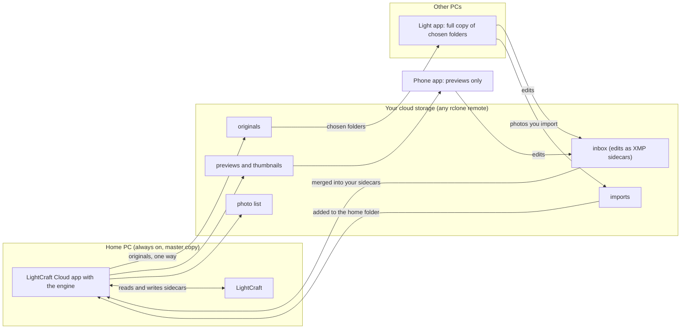

# LightCraft Cloud

Lightroom-style sync for [LightCraft](https://github.com/storytold/lightcraft), using your own cloud storage. Your photos stay on your PC. The cloud is only a go-between.

What you get:

* Browse your library on your phone and edit photos there. The edits come back to LightCraft on your PC.
* Keep a full copy of chosen folders on a second PC, edit there too, and import new photos there.
* Use any cloud storage that [rclone](https://rclone.org) supports: Google Drive, OneDrive, S3, WebDAV, SFTP and more. There is no server of ours.

## How the parts fit

Three rules hold everywhere:

* Originals only travel one way: from the home PC out to the cloud and your other PCs. Photo files are never changed.
* Edits travel back as small XMP sidecar files through the inbox. The home PC merges them into its own sidecars.
* Deletions spread only from the home PC. Deleting on another PC only affects that PC.

## The parts

| Part | What it is | Where |
| --- | --- | --- |
| Phone app | Android app. Shows thumbnails and small previews, lets you edit, sends the edits back. Holds no originals. | [lightcraft-android](https://github.com/tinytom21/lightcraft-android), downloads on its [Releases](https://github.com/tinytom21/lightcraft-android/releases) page |
| Home PC app | Tray app on the PC where your master library lives. Publishes your photo folder, makes previews with LightCraft's engine, applies edits that arrive. Linux only for now. | This repository, [Releases](https://github.com/tinytom21/lightcraft-cloud/releases) |
| Other-PC app | The same tray app without the engine. Keeps a copy of the folders you choose, sends back edits and imported photos. Windows and Linux. | This repository, [Releases](https://github.com/tinytom21/lightcraft-cloud/releases) |

The PC apps are one program, `lightcraft-cloud-desktop`, built two ways. The phone app is a fork of LightCraft for Android.

## What it does, day to day

* **Edits.** Edit a photo in LightCraft on any PC, or on the phone. The edit is saved as an XMP sidecar next to the photo, travels through the cloud and ends up on every device. If two devices changed the same photo, the settings are merged and the newer edit wins any clash.
* **Imports.** On another PC, import photos in LightCraft into the synced folder, in any folder structure you like. The app keeps your folder structure, sends the photos to the home PC, and they appear in LightCraft there.
* **Live progress.** The tray icon changes colour while it works, and the Status window shows what is happening and what is waiting.
* **Refresh of LightCraft.** The app tells your running LightCraft about new photos and new edits, so you do not have to run Synchronize Folder. This needs LightCraft to be running and its control port to be on (see Quick start).

## Quick start

Setup is manual today. You need an rclone remote for your cloud storage (`rclone config`). The phone connects with a config file exported from the PC. There is no QR pairing.

Downloads for Windows and Linux will be on the [Releases](https://github.com/tinytom21/lightcraft-cloud/releases) page from v0.2.0.

**1. LightCraft settings, on every PC.** In LightCraft open Settings, then the Import tab. Under XMP sidecars tick **Automatically write changes into XMP sidecars** and set **Sidecar names** to `IMG_1.CR3.xmp`. Without this, edits stay inside LightCraft and are never sent.

**2. LightCraft control port, on every PC.** This lets the app tell LightCraft about new photos and edits. The port listens on this PC only and has no password. Then restart LightCraft.

* Linux Flatpak: `flatpak override --user --env=LIGHTCRAFT_CONTROL_PORT=7980 ai.storyteller.lightcraft`
* Windows: `setx LIGHTCRAFT_CONTROL_PORT 7980`

**3. Home PC (Linux).**

1. Download the app from Releases and start it. Setup opens on the first run.
2. Choose **This is my home PC**, your photo folder and your rclone remote with a folder on it.
3. Choose "Originals and previews", or "Previews only" if you do not want the originals in the cloud.
4. Save. The first sync starts and uploads the library.

**4. Another PC.**

1. Windows: run the installer from Releases. Linux: download the app from Releases.
2. Start it. Setup opens on the first run. Choose **This is another PC**.
3. Pick the cloud library, a photo folder on this PC, and tick the folders to keep.
4. Add that photo folder to LightCraft, and set LightCraft's import destination to it.

**5. Phone.**

1. Install the APK from the [phone app Releases](https://github.com/tinytom21/lightcraft-android/releases).
2. On the home PC, export a phone-only rclone remote to a config file, and copy it to the phone.
3. In the app's Preferences pick the file, the remote and a name for the phone. The [phone guide](https://github.com/tinytom21/lightcraft-android/blob/lightcraft-cloud/apps/lightcraft-android/docs/cloud-library.md) has the steps.

## Status and limits

This is early software.

* Albums and uploading photos from the phone are not built.
* The Windows app is not code-signed, so Windows SmartScreen warns when you first run it.
* The home PC app is Linux only. A Mac build does not exist.
* LightCraft must be running for the automatic refresh to work. Without it the photos and sidecars still arrive; run Synchronize Folder in LightCraft.
* On Linux the app needs rclone's `librclone.so` library in a place it looks; see the [config reference](docs/desktop-app.md#config).

## Docs

* [Desktop app](docs/desktop-app.md): behaviour, another PC, config reference, how LightCraft is told about changes.
* [Cloud layout](FORMAT.md): the files in the cloud and the inbox protocol.
* [Building and testing](docs/building.md): repository layout, build, Windows build, tests.
* [The old Python tool](docs/legacy-lc-cloud.md): `lc-cloud`, the first version, replaced by the desktop app.

## Licence and credits

License: MIT OR Apache-2.0. See [LICENSE-MIT](LICENSE-MIT) and [LICENSE-APACHE](LICENSE-APACHE).

This is an independent project. It builds on [LightCraft](https://github.com/storytold/lightcraft) by storytold, [LightCraft for Android](https://github.com/artcraft-android/lightcraft-android), and [rclone](https://rclone.org). Thanks to their authors.
